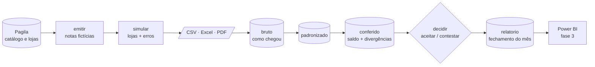

# Hermes

Pipeline de dados de uma **distribuidora fictícia de filmes em DVD que trabalha em consignação**.
A distribuidora emite as remessas para as lojas parceiras, recebe de volta os relatórios mensais de
venda (em CSV, Excel ou PDF, cada loja de um jeito e com erros), concilia tudo contra o que foi
enviado e fecha o mês com o faturamento real, o repasse e o lucro.

> Projeto de portfólio. Lojas, vendas e notas fiscais são **fictícias**: as notas são marcadas
> como fictícias, sem chave de acesso nem CNPJ. O catálogo e as lojas vêm do banco de exemplo
> [Pagila](https://github.com/devrimgunduz/pagila).

## O negócio

Consignação: a loja só paga o que vendeu e devolve o que não vendeu.

> A distribuidora manda **10** DVDs. A loja devolve **2** e vende **8** a R$ 29,90 → venda de
> R$ 239,20. A loja fica com a comissão de 30% (R$ 71,76) e repassa **R$ 167,44**. O custo dos 8
> para a distribuidora é R$ 95,68, e o **lucro é R$ 71,76**.

- **Contrato** por loja: preço fixo por faixa (R$ 19,90 · 29,90 · 39,90), comissão de 30% e
  frete embutido.
- **Mês a mês:** a remessa repõe cada título até um estoque-alvo; até o dia 10 do mês seguinte a
  loja manda o relatório (vendido, devolvido, estoque e o repasse que ela calculou).
- **Regra central da conciliação**, por loja, título e mês:
  `estoque inicial + recebido = vendido + devolvido + estoque final`.

## Como funciona



Cada camada é um schema do PostgreSQL, ao lado do Pagila, que só é lido. O Python lê os arquivos e
grava em `bruto`; as passagens seguintes são SQL versionado em
[`src/hermes/infra/sql/`](src/hermes/infra/sql/).

- **Leitura de PDF em duas tentativas:** primeiro PyMuPDF; se a leitura falhar (sem cabeçalho, sem
  linhas ou com colunas a mais), pdfplumber. O banco guarda qual dos dois leu cada arquivo.
- **Reproduzível:** a mesma semente gera os mesmos arquivos e o mesmo fechamento.
- **Idempotente:** importar o mesmo arquivo de novo não duplica nada; um arquivo novo da mesma loja
  e mês substitui o anterior e reabre a conferência.
- **Gabarito:** o simulador anota cada erro que pôs, e os testes provam que a conciliação acha
  todos.

### O que a conciliação pega

Exemplos reais de `hermes rodar 2025-08 2026-07`:

| Divergência | Exemplo | Decisão automática |
|---|---|---|
| `SALDO_NAO_FECHA` | loja 147, BRINGING HYSTERICAL: a loja diz 4 em estoque, a conta dá 2 | contestada: a diferença é cobrada a preço de custo |
| `REPASSE_DIVERGENTE` | loja 196 declarou R$ 4.011,93; o contrato dá R$ 3.962,49 | contestada (acima de R$ 10) |
| `PRECO_DIVERGENTE` | loja 311 vendeu HUMAN GRAFFITI a R$ 39,90; a tabela é R$ 29,90 | contestada: vale o contrato |
| `TITULO_NAO_ENVIADO` | loja 11 relatou HOMEWARD CIDER, que nunca recebeu | contestada |
| `TITULO_AUSENTE` | loja 270 esqueceu ENEMY ODDS, com 3 em estoque | aceita: sem movimento |
| `DUPLICADO` | loja 235 escreveu BEACH HEARTBREAKERS duas vezes | contestada: vale a primeira linha |
| `RELATORIO_ATRASADO` | loja 51 mandou depois do dia 10 | aceita |
| `RELATORIO_FALTANDO` | loja 219 não mandou o de 10/2025 | o mês fecha sem venda e o estoque passa igual |

Nos 12 meses: 74 divergências (48 contestadas, 26 aceitas), 283 arquivos lidos (83 PDFs, todos na
primeira tentativa), venda de R$ 1,53 milhão e lucro de R$ 459 mil.

## Arquitetura

```
src/hermes/
  interface/    linha de comando (uma tela, depois): não decide fluxo nem grava nada
  application/  o ciclo do mês, na ordem certa; CLI e tela futura usam o mesmo
  services/     regras de negócio e validação
  domain/       interpretação de cada documento (relatório da loja, nota fiscal), sem I/O
  core/         modelos e regras puras: dinheiro, sorteio, meses, normalização
  infra/        só I/O: banco, leitores, escritores, PDF e os .sql
  config/       .env e o contrato padrão
```

Um teste ([`tests/test_camadas.py`](tests/test_camadas.py)) garante que cada camada só importa o
que pode.

## Como rodar

Precisa de PostgreSQL com o Pagila carregado num banco `pagila` e de Python 3.12+.

```powershell
python -m venv mensagem
mensagem\Scripts\pip install -e .[dev]
copy .env.example .env   # e preencha PGPASSWORD
mensagem\Scripts\hermes preparar
mensagem\Scripts\hermes rodar 2025-08 2026-07
```

Ou passo a passo, mês a mês:

```
hermes emitir 2025-08        # remessas e notas (saida/notas/)
hermes simular 2025-08       # relatórios das lojas (entrada/2025-08/)
hermes importar 2025-08
hermes conferir 2025-08
hermes divergencias 2025-08
hermes decidir 12 contestar "loja contou errado"
hermes fechar 2025-08
```

Testes (criam um banco `hermes_teste` com o Pagila; precisam de `PAGILA_SQL_DIR` no `.env`):

```powershell
mensagem\Scripts\pytest --cov=hermes
```

98 testes, 97% de cobertura.

## Fases

1. **Back-end** (este repositório): pipeline, conciliação e fechamento.
2. Leitura de relatório escrito à mão (OCR) e, talvez, uma tela.
3. Painel no Power BI sobre o schema `relatorio`: sell-in × sell-out, giro, estoque nas lojas,
   margem por loja e por categoria.

## Licença

[MIT](LICENSE).
